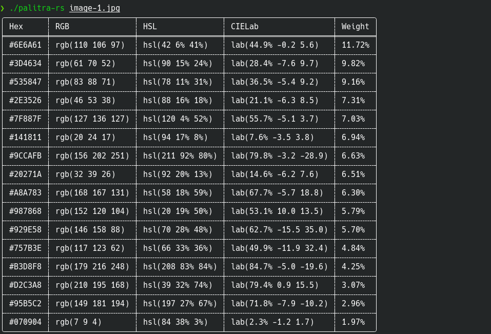
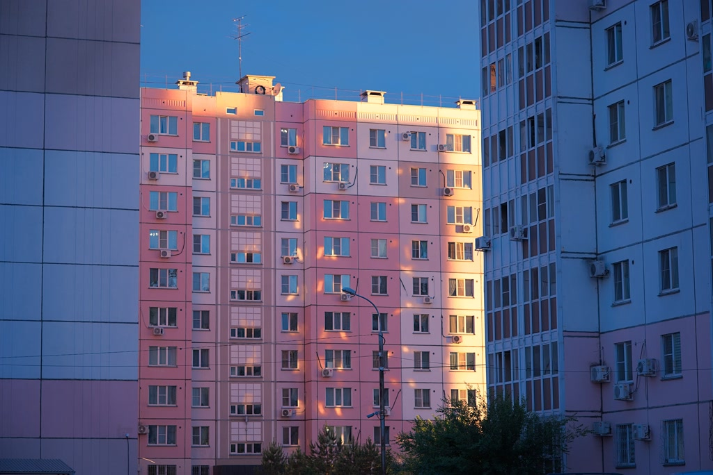

# palitra-rs

A command-line tool to extract dominant color palettes from images using **k-means clustering**.

Written in Rust, works on Windows, Linux, and macOS.



## Features

- Extracts color palettes from images in the following formats: `JPEG`, `PNG`, `GIF`, `WEBP`, `AVIF`, `BMP`, `TIFF`, `ICO`.
- Exports colors in `HEX`, `RGB`, `HSL`, or `CIELab` formats.
- Outputs palettes as a formatted table, list, single line, or JSON.
- Supports configurable palette size (from 1 to 64 colors).
- Saves a palette preview as an image file (`JPEG`, `PNG`, `GIF`, `WEBP`, `BMP`).
- Runs as a single executable with no external dependencies.

## Examples


By default, the program outputs a palette of 16 colors, but you can choose your own number up to 64.

```bash
./palitra-rs -c 3 -s 16 -i image-1-palette-3.jpg image-1.jpg
```


```bash
./palitra-rs -c 8 -s 16 -i image-1-palette-8.jpg image-1.jpg
```


```bash
./palitra-rs -c 16 -s 16 -i image-1-palette-16.jpg image-1.jpg
```


```bash
./palitra-rs -c 24 -s 16 -i image-1-palette-24.jpg image-1.jpg
```


```bash
./palitra-rs -c 32 -s 16 -i image-1-palette-32.jpg image-1.jpg
```


Colors are sorted by frequency (weight), with the most dominant colors appearing first.

Here are a few more example images:





## Building from source code

Ensure you have [Rust and Cargo](https://rustup.rs/) installed, then run:

```bash
git clone https://github.com/IvanZhuck/palitra-rs
cd palitra-rs
cargo build --release
```

The compiled binary will be available at `target/release/palitra-rs`.

## Usage

Ensure the file `palitra-rs` is executable and run:

```bash
./palitra-rs [OPTIONS] <INPUT_FILE>
```

Where:

`<INPUT_FILE>` — Path to the input image (supported formats: jpeg, png, gif, webp, avif, bmp, tiff, ico).

Options:

- `-c`, `--colors` — Number of colors to generate. Between 1 and 64, default: 16.
- `-o`, `--output-format` — Output format, possible values: table, list, line, json-object, json-array, default: table.
- `-f`, `--color-format` — Output color format, possible values: hex, rgb, hsl, lab, default: hex. Not applicable when output format is table (the table displays all formats at the same time).
- `-i`, `--output-image-file` — Path to the output image file (supported formats: jpeg, png, gif, webp, bmp).
- `-s`, `--swatch-size` — Palette swatch size in pixels for the output image. Between 10 and 512, default: 50.
- `-h`, `--help` — Print help information.

## How fast is it
## FAQ


